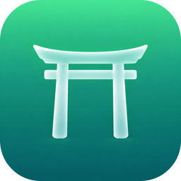

<p align="center"></p>

# Minato

Minato is in public beta: many apps run, some don't yet. If one doesn't,
[report it](https://github.com/Kisame76/minato/issues/new?template=app-report.yml).

Minato runs Android apps and games on the iPhone. It is not an emulator: the app's ARM64 code runs directly on the
iPhone's CPU, and Minato recreates the Android environment around it, the way Wine recreates Windows on other
systems. You add an APK to Minato's library, and one tap starts it.

The name is Japanese: 港, *minato*, a harbor; in Old Japanese, "the gate of the water".

## How it works

When you import an app, Minato reads its manifest, resources and signatures, picks the parts built for 64-bit ARM, and
checks every native library. iOS runs only signed code, so each library is converted at import: a few machine
instructions that cannot work on iOS (the thread pointer, Linux system calls, the `x18` register) are replaced, and the
library is packed into a Mach-O file that Minato signs on the device with the same certificate it was installed with;
the certificate and its key stay in the iPhone's keychain. A library that holds something no replacement can run is
refused at import with every reason at once; a word that no current CPU can execute is kept as it is and counted. When
the app starts, Minato restarts itself into that app. Its own loader links the libraries as Android's linker would, on
top of AOSP's real C library (Bionic) and a Linux system-call layer written for iOS. Java and Kotlin code runs on AOSP's
ART, built for this purpose, with Android's Java framework running inside the same process. Graphics go through ANGLE
(OpenGL ES on Metal) and MoltenVK (Vulkan on Metal); sound, touch, keys, sensors, location, file pickers and links are
bridged to their iOS counterparts. [docs/ARCHITECTURE.md](docs/ARCHITECTURE.md) has the details.

## Status

Native games and apps (C and C++ with OpenGL ES or Vulkan) run, and so do Java and Kotlin apps that stay within the
parts of Android Minato already provides. A self-built Godot game runs as fast as its native iOS build. Apps can use the
camera through Android's older Camera API, record with the microphone, read game controllers, show web pages inside the
app and play sound, music and effects; the camera and the microphone are new and not yet checked on the iPhone. Many
real apps still stop at something that is missing: Camera2 and CameraX, saving audio or video to a file, and parts of
the framework. Java code runs on ART's fast interpreter and is compiled once after an app's first close, so Java-heavy
apps can still be slower than on a phone.
[docs/COMPATIBILITY.md](docs/COMPATIBILITY.md) lists what works, what is missing and what each engine does.

The performance goal is parity with the native iOS version of the same app on the same iPhone: at least 95 % of its
frames per second, with a p99 frame time at most 5 % longer. Measurements are in
[docs/BENCHMARKS.md](docs/BENCHMARKS.md).

## Supported formats

- `.apk`, including fat APKs (Minato uses their arm64-v8a code) and APKs with uncompressed native libraries
- split APKs, as loose files or a folder
- `.apks` (bundletool, SAI, App Manager) and a plain `.zip` of APKs
- `.xapk` with its OBB files, and single `.obb` files added to an installed app
- `.apkm` without encryption (encrypted `.apkm` files are refused with a message)
- Play Asset Delivery and Feature Delivery packs that come with the import
- `.aab` only through a Mac tool that turns it into a universal APK (`tools/aab-to-apk.sh`)

## What does not work, and never will

These are limits by design or set by iOS, not missing features:

- **No 32-bit and no x86 code.** Minato runs arm64-v8a code only, without emulation; iPhones cannot run 32-bit ARM
  code. APKs with only 32-bit libraries are marked "Incompatible" at import.
- **No JIT.** iOS gives apps no memory that is both writable and executable. Runtimes that compile machine code
  while they run (Mono and .NET, LuaJIT with its JIT on, emulators' dynamic recompilers) fail unless they have an
  interpreter. An optional JIT path through StikDebug may come later; it will never be required.
- **No Google Play services.** Minato reports them as absent. Push messages, Play Billing, Play Games, Google
  Sign-In, the Maps SDK and Play Integrity do not work.
- **No bypassing** of Play Integrity, license checks, anti-cheat or DRM. Apps that enforce them refuse to run, and
  DRM-protected video does not play.
- **One app at a time.** Each app runs in Minato's own process, and nothing runs in the background.
- **No system roles:** no launchers, keyboards, accessibility services, VPN, SMS or phone apps, overlays or home
  screen widgets; no telephony, NFC or USB host.

## Installing

Minato is distributed only by sideloading with [SideStore](https://sidestore.io) or
[AltStore](https://altstore.io). It is not in the App Store and not on TestFlight.

1. Download `Minato.ipa` from the latest release on this repository's Releases page.
2. Install it with SideStore or AltStore.
3. Open Minato once. It needs the certificate it was signed with, to sign the code of the apps you import: with
   SideStore it takes it by itself; with AltStore it asks you once to tap "Export" there.
4. Add apps with "+" in the library, or with "Open with" from the Files app. The original file stays where it is.
   Tap an app to start it.

What a free Apple account means:

- The installation must be refreshed every 7 days, as with any sideloaded app. Imported apps and their data stay.
- iOS allows three sideloaded apps per device, SideStore or AltStore included, and 10 new App IDs per week.
- An app gets a limited share of the phone's memory. Minato asks for the increased memory limit, which a free
  account through SideStore does not receive (Get Info shows whether it is there). Most apps fit; very large
  games may not.

Minato supports the iPhone 15 Pro Max and newer with iOS 26 or later, and is tested on an iPhone 15 Pro Max. It is
developed and measured on iOS 27 with an A17 Pro. Releases are betas, listed in [CHANGELOG.md](CHANGELOG.md).

## Leaving an app

An app fills the whole screen. To get back to Minato, open Minato's menu and tap Quit:

- swipe down with three fingers anywhere on the screen, or
- swipe down from the top edge. iOS keeps that edge for itself too, so sometimes it takes a second swipe.

The menu also turns the frame rate display on and off. Settings › How to Use Minato shows this again.

## Building

Minato builds on a Mac with Apple silicon, Xcode 27, CMake, Ninja, XcodeGen and the Android NDK r30. The build
fetches and compiles AOSP's Bionic and ART, ANGLE and MoltenVK from pinned sources. Start with
[docs/BUILDING.md](docs/BUILDING.md); in short, after the guest system is built:

```bash
tools/sim.sh       # build and run in the Simulator
tools/deploy.sh    # build, install and run on a connected iPhone
```

## Documentation

- [docs/ARCHITECTURE.md](docs/ARCHITECTURE.md): how Minato works, component by component
- [docs/DESIGN.md](docs/DESIGN.md): the index of design decisions (the ADR numbers cited in the code)
- [docs/COMPATIBILITY.md](docs/COMPATIBILITY.md): what runs, what is missing, engines and limits
- [docs/BUILDING.md](docs/BUILDING.md): toolchain, sources, build scripts, Simulator and iPhone
- [docs/TESTING.md](docs/TESTING.md): tests, check scripts and Android reference logs
- [docs/BENCHMARKS.md](docs/BENCHMARKS.md): the parity measurements
- [docs/RELEASING.md](docs/RELEASING.md): versions and how a release is made
- [CHANGELOG.md](CHANGELOG.md): what changed in each release
- [CONTRIBUTING.md](CONTRIBUTING.md) and [SECURITY.md](SECURITY.md)
- [THIRD_PARTY.md](THIRD_PARTY.md): third-party code, versions and licenses

## License

Minato is licensed under the Apache License 2.0, see [LICENSE](LICENSE). It builds on third-party code under its own
licenses, listed in [THIRD_PARTY.md](THIRD_PARTY.md); the app carries their license texts. ART's class library
(libcore) is under GPL-2.0 with the Classpath Exception and ships as a separate component.

Minato is an independent project, not affiliated with Google or Apple. Android is a trademark of Google LLC.
